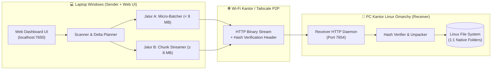

# 🚀 NovaShare

**High-Throughput, Zero-Corruption Cross-Platform Backup & File Transfer Engine (Windows Laptop $\rightarrow$ Linux Omarchy PC)**

[](https://bun.sh)
[](#arsitektur-sistem)
[](#fitur-unggulan)
[](#lisensi)

**NovaShare** adalah aplikasi backup dan sinkronisasi satu arah (*one-way backup*) yang dirancang khusus untuk mengirim data berukuran **ratusan Gigabyte (GB)** sekaligus **ratusan ribu file kecil** dari laptop **Windows** ke PC kantor **Linux (Omarchy)** melalui jaringan **Wi-Fi Kantor (LAN)** maupun **Tailscale VPN**.

Berbeda dengan pengirim file biasa yang gagal total saat koneksi Wi-Fi terputus di tengah jalan, NovaShare menggabungkan kemudahan antarmuka ala *LocalSend* dengan ketangguhan mesin **Dual-Lane Pipeline (Micro-Batching + 8 MB Chunk Streaming)**, verifikasi *hash* kriptografis per blok, serta **Auto-Resume** instan.

---

## ✨ Fitur Unggulan

- 🧱 **Chunked Streaming untuk File Ratusan GB (Jalur B):**
  File berukuran besar (`>= 8 MB` hingga ratusan GB) dibaca langsung menggunakan *byte-offset stream* per **8 MB** tanpa menduplikasi file di disk laptop. Penggunaan RAM tetap rendah (`< 150 MB`) meskipun mengirim file 500 GB.
- 📦 **Micro-Batching di RAM untuk Ribuan File Kecil (Jalur A):**
  Ratusan file kecil (`< 8 MB` seperti *source code*, dokumen, aset) digabungkan secara otomatis di memori menjadi satu paket `~8 MB` sebelum dikirim, menghilangkan *network round-trip overhead* di Wi-Fi.
- 🛡️ **Anti-Korup (Per-Chunk Cryptographic Hash):**
  Setiap potongan 8 MB dan setiap paket *batch* diverifikasi menggunakan `SHA-256` / `BLAKE2b` di PC Linux sebelum ditulis ke disk. Jika ada 1 bit yang rusak karena gangguan sinyal Wi-Fi, hanya potongan 8 MB tersebut yang dikirim ulang.
- 🔄 **Instant Auto-Resume & Atomic Write (`.novapart`):**
  Jika Wi-Fi kantor terputus, laptop *sleep*, atau dibawa pulang, proses transfer otomatis jeda (*pause*) dan melanjutkan tepat dari *chunk* terakhir (lewat Wi-Fi kantor maupun IP Tailscale) tanpa mengulang dari 0%.
- 🐧 **1:1 Native Folder Structure & Remote Linux Explorer:**
  File disimpan di PC Linux sesuai struktur folder aslinya (bukan dikunci dalam satu file `.tar`/`.zip`). Pengguna dapat menelusuri direktori Linux (`/home`, `/mnt`, dll.), membuat folder baru, dan melihat **sisa ruang disk (Free Space)** Linux langsung dari layar laptop Windows.
- ⚡ **Delta Sync & Smart Ignore:**
  Membandingkan `size` dan waktu modifikasi (`mtime`) terlebih dahulu sehingga file yang belum berubah dilewati dalam hitungan milidetik. Dilengkapi filter opsional untuk mengabaikan folder sampah (`node_modules`, `.git`, `vendor`, dll.).

---

## 🏗️ Arsitektur Sistem

NovaShare menggunakan arsitektur **Single Codebase, Dual-Role** yang dapat dijalankan langsung menggunakan **Bun** atau dikompilasi menjadi *single-file executable* mandiri:



---

## 📂 Struktur Direktori

```text
nova-share/
├── prd.md                        # Product Requirements Document (PRD) lengkap
├── README.md                     # Dokumentasi utama project
├── package.json                  # Script runner & kompilasi binary (Windows & Linux)
├── tsconfig.json                 # Konfigurasi TypeScript
├── src/
│   ├── index.ts                  # Entry point CLI (--sender, --receiver, atau dual-mode)
│   ├── shared/                   # Modul bersama (types, constants, hash, batch-codec, path-utils)
│   ├── receiver/                 # Daemon penerima di Linux Omarchy (API, fs-browser, chunk/batch writer)
│   ├── sender/                   # Mesin pengirim di Windows (scanner, transfer-manager, speed throttler)
│   └── ui/                       # Dashboard Web UI (HTML/CSS/JS)
├── scripts/                      # Skrip starter (start-windows.bat, start-linux.sh, novashare.service)
└── dist/                         # Hasil compile executable mandiri
```

---

## 🚀 Cara Instalasi & Penggunaan

### Prasyarat
- [Bun](https://bun.sh) `>= 1.1+` (untuk menjalankan dari *source* atau melakukan kompilasi binary).
- Koneksi jaringan yang menghubungkan Laptop Windows dan PC Linux Omarchy (**Wi-Fi Kantor yang sama** atau **Tailscale VPN**).

### 1. Menjalankan di PC Kantor (Linux Omarchy — Mode Receiver)
Jalankan Receiver Daemon di PC Linux dengan menentukan port dan *Secret Token*:
```bash
# Menjalankan dari source
NOVA_TOKEN="rahasia-kantor-123" bun run src/index.ts --receiver --port 7654

# Atau jika menggunakan binary hasil compile:
NOVA_TOKEN="rahasia-kantor-123" ./dist/novashare-linux --receiver --port 7654
```

### 2. Menjalankan di Laptop (Windows — Mode Sender + Web UI)
Jalankan Sender di laptop Windows, lalu buka browser ke `http://localhost:7650`:
```bash
bun run src/index.ts --sender --ui-port 7650
```
*(Untuk pengujian lokal di 1 komputer, jalankan `bun run dev` untuk menyalakan Sender sekaligus Receiver secara bersamaan).*

### 3. Kompilasi Menjadi Aplikasi Mandiri (Single Executable)
Anda dapat membungkus NovaShare menjadi 1 file `.exe` untuk Windows dan 1 file binary untuk Linux Omarchy (tanpa perlu install Bun/Node di PC Linux):
```bash
# Build untuk Windows (menghasilkan dist/novashare-windows.exe)
bun run build:windows

# Build untuk Linux x64 (menghasilkan dist/novashare-linux)
bun run build:linux
```

---

## 🌿 Alur Kerja Git (Git Workflow)

Repositori ini dikelola dengan standar pengembangan profesional:
- **`main`**: Branch utama yang stabil dan siap rilis (*production-ready*).
- **`develop`**: Branch integrasi untuk pengembangan fitur.
- **`feat/<nama-fitur>`** / **`fix/<nama-bug>`**: Branch spesifik untuk setiap *Issue* dan *Pull Request*.
- Setiap perubahan fitur wajib melalui **Issue Tracking** dan **Pull Request (PR)** dengan mengikuti format [Conventional Commits](https://www.conventionalcommits.org/) (`feat:`, `fix:`, `docs:`, `chore:`, `refactor:`).

---

## 📄 Dokumentasi Lengkap

Spesifikasi teknis mendalam mengenai protokol chunking, struktur file `.novapart`, kontrak REST API, dan skenario *auto-resume* dapat dilihat pada dokumen **[Product Requirements Document (`prd.md`)](./prd.md)**.

---

## 📝 Lisensi

Didistribusikan di bawah lisensi **MIT**. Lihat informasi lebih lanjut pada repositori ini.
