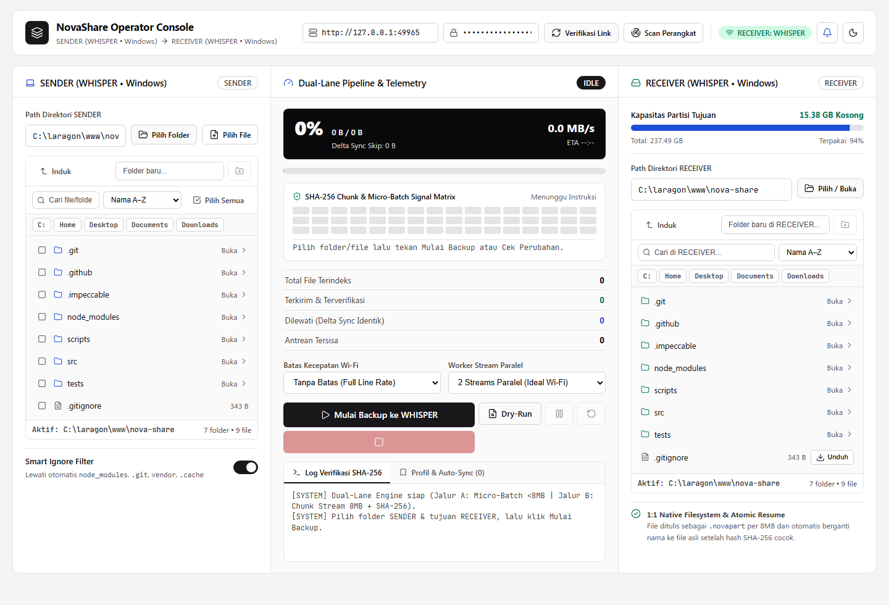
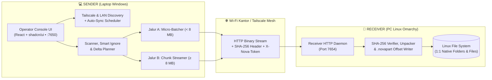

<div align="center">

# ⚡ NovaShare

**High-Throughput, Zero-Corruption Cross-Platform Backup & File Transfer Engine**  
*Built for Unattended Multi-Hundred-GB & Hundred-Thousand-File Transfers Between Windows Workstations and Linux (Omarchy) Servers over Office Wi-Fi & Tailscale*

[](https://github.com/rheatkhs/nova-share/releases)
[](https://bun.sh)
[](./DESIGN.md)
[](#arsitektur-sistem)
[](#fitur-utama)
[](#pengujian-otomatis-testing)
[](#lisensi)

</div>

---

## 📸 Tampilan Operator Console (v1.2)



> **Dual-Bus Studio Patch Bay & Operator Deck:** Antarmuka web lokal (`localhost:7650`) berbasis **React**, **shadcn/ui**, dan **Lucide Icons** yang menampilkan jembatan tiga kolom antara **SENDER**, **Dual-Lane Pipeline & Telemetry (48-Cell SHA-256 Signal Matrix)**, dan **RECEIVER** lengkap dengan *Light/Dark Mode*.

---

## 🎯 Mengapa NovaShare?

Membackup data kerja dari laptop **Windows** ke PC kantor **Linux (Omarchy)** melalui jaringan Wi-Fi kantor sering terkendala oleh dua skenario ekstrem:
1. **File Raksasa (Puluhan hingga Ratusan GB):** Pengiriman file utuh rentan gagal atau korup jika Wi-Fi kantor *drop* sesaat, laptop *sleep*, atau jam pulang kantor tiba. Mengulang dari `0%` sangat membuang waktu.
2. **Ratusan Ribu File Kecil (*Source Code*, Dokumen, Aset):** Mengirim file kecil satu per satu menyebabkan *network round-trip overhead* dan *disk I/O bottleneck* yang menjatuhkan kecepatan transfer hingga di bawah `1 MB/s`.

**NovaShare** menyelesaikan keduanya melalui arsitektur **Dual-Lane Pipeline** yang mempertahankan **struktur folder asli 1:1** di mesin tujuan (tanpa mengunci data di dalam archive `.tar`/`.zip`).

---

## ✨ Fitur Utama

### 1. Mesin Transfer Dual-Lane & Anti-Korup
- **🧱 Jalur B — 8 MB Chunked Streaming (File Ratusan GB):**
  File berukuran besar (`>= 8 MB` hingga ratusan GB) dibaca langsung dari disk menggunakan *byte-offset stream* per **8 MB** tanpa menduplikasi file di laptop. Penggunaan RAM tetap rendah (`< 150 MB`) walau mengirim file 500 GB.
- **📦 Jalur A — In-Memory Micro-Batching (Ribuan File Kecil `< 8 MB`):**
  Ratusan file kecil digabungkan secara otomatis di RAM menjadi satu paket biner `~8 MB` sebelum dikirim, menghilangkan *overhead* bolak-balik jaringan di Wi-Fi.
- **🛡️ Per-Chunk SHA-256 Verification & Atomic Rename (`.novapart`):**
  Setiap potongan 8 MB dan setiap paket *batch* diverifikasi menggunakan `SHA-256` (`Bun.CryptoHasher`) di RECEIVER sebelum ditulis ke disk. Selama transfer berlangsung, file disimpan sebagai `<namafile>.novapart` + `.novapart.meta.json` dan baru diubah namanya menjadi file asli secara atomik setelah `100%` chunk terverifikasi.
- **🔄 Instant Auto-Resume & Network Drop Recovery:**
  Jika Wi-Fi kantor putus atau laptop dibawa pulang, proses otomatis masuk ke mode `WAITING_FOR_NETWORK` dan melanjutkan tepat dari indeks *chunk* 8 MB terakhir saat terhubung kembali (baik lewat Wi-Fi kantor maupun IP **Tailscale**).

### 2. Usability Suite (v1.2)
- **📡 Auto-Discovery Perangkat (Tailscale & LAN Scanner):**
  Mendeteksi otomatis daftar perangkat di jaringan **Tailscale** (`tailscale status --json`) dan LAN lokal yang menjalankan NovaShare Receiver, sehingga pengguna cukup memilih perangkat dengan 1 klik.
- **🔍 Inline Directory & File Explorer (Search, Sort & Selective Transfer):**
  Menampilkan folder sekaligus file lengkap dengan ukurannya di SENDER maupun RECEIVER. Mendukung pencarian instan, pengurutan (*Nama A–Z*, *Ukuran Terbesar*, *Terbaru Diubah*), pemilihan file spesifik via *checkbox* atau dialog native Windows Explorer (**Pilih Folder** & **Pilih File**).
- **🧪 Pre-Flight Dry-Run Preview:**
  Menghitung terlebih dahulu berapa GB dan berapa file yang benar-benar baru/berubah vs yang akan di-*skip* oleh **Delta Sync** (`size` + `mtime`), sekaligus memvalidasi kecukupan sisa ruang disk (`statfs`) di RECEIVER sebelum mengirim data.
- **📥 Two-Way File Download (RECEIVER $\rightarrow$ SENDER):**
  Unduh file apa pun langsung dari daftar direktori RECEIVER (PC Linux) kembali ke laptop SENDER dengan 1 klik.
- **⏱️ Auto-Sync Profile Scheduler:**
  Simpan pasangan folder `SENDER -> RECEIVER` sebagai profil dan atur jadwal otomatis: *Manual*, *Auto saat Receiver Online*, *Auto Tiap 1 Jam*, atau *Auto Tiap 4 Jam*.
- **🔔 Desktop Notification & Audio Cue:**
  Notifikasi browser dan indikator suara halus saat backup selesai `100%` atau ketika koneksi jaringan terputus.

---

## 🏗️ Arsitektur Sistem

NovaShare menggunakan arsitektur **Single Codebase, Dual-Role** yang dapat dijalankan langsung menggunakan **Bun** atau dikompilasi menjadi *single-file executable* mandiri:



---

## 📂 Struktur Direktori

```text
nova-share/
├── README.md                     # Dokumentasi utama project
├── prd.md                        # Product Requirements Document (PRD)
├── PRODUCT.md                    # Kontrak kebenaran produk & konteks operasional
├── DESIGN.md                     # Spesifikasi Design System (Tokens, Typography, Rules)
├── package.json                  # Konfigurasi script runner, bundler UI, & kompilasi binary
├── tsconfig.json                 # Konfigurasi TypeScript
│
├── src/
│   ├── index.ts                  # Entry point CLI (--sender, --receiver, --dual)
│   ├── shared/                   # Modul bersama (types, constants, hash, batch-codec, path-utils)
│   ├── receiver/                 # Daemon penerima (server, fs-browser, sync-planner, chunk/batch writer)
│   ├── sender/                   # Mesin pengirim (server, transfer-manager, scanner, discovery, scheduler)
│   └── ui/                       # React + shadcn/ui + Lucide Operator Console
│       ├── client.tsx            # Aplikasi utama Dual-Bus Studio Patch Bay
│       ├── components/shadcn.tsx # Komponen primitif shadcn/ui
│       ├── index.html            # HTML root & kontrak desain
│       ├── styles.css            # Design system tokens (Light default & Dark workstation mode)
│       └── app.js                # Bundle produksi ter-minifikasi
│
├── scripts/                      # Skrip starter & deployment
│   ├── start-windows.bat         # Launcher 1-klik untuk Windows (Sender + Browser)
│   ├── start-linux.sh            # Launcher untuk Linux Omarchy (Receiver + info IP Tailscale)
│   └── novashare.service         # Unit systemd untuk auto-start saat PC Linux menyala
│
├── tests/                        # Suite pengujian unit & integrasi otomatis (bun test)
└── docs/                         # Aset gambar dokumentasi
```

---

## 🚀 Panduan Instalasi & Penggunaan

### Prasyarat
- **[Bun](https://bun.sh) `>= 1.1+`** (untuk menjalankan dari *source* atau melakukan kompilasi binary).
- Koneksi jaringan yang menghubungkan SENDER dan RECEIVER (**Wi-Fi Kantor yang sama** atau **Tailscale VPN**).

### 1. Instalasi Dependency
```bash
git clone https://github.com/rheatkhs/nova-share.git
cd nova-share
bun install
```

### 2. Menjalankan di PC Kantor (Linux Omarchy — Mode RECEIVER)
Jalankan Receiver Daemon di PC Linux pada port `7654` dengan *Secret Token*:
```bash
# Menggunakan script starter (otomatis menampilkan IP Tailscale jika ada):
NOVA_TOKEN="rahasia-kantor-123" ./scripts/start-linux.sh

# Atau langsung via Bun:
NOVA_TOKEN="rahasia-kantor-123" bun run start:receiver
```

<details>
<summary><b>⚙️ Opsional: Menjadikan Background Service Otomatis (systemd) di Linux Omarchy</b></summary>

Agar Receiver selalu menyala otomatis setiap kali PC Linux kantor dihidupkan:
```bash
bun run build:linux
sudo cp dist/novashare-linux /usr/local/bin/novashare-linux
sudo chmod +x /usr/local/bin/novashare-linux
sudo cp scripts/novashare.service /etc/systemd/system/novashare@.service
sudo systemctl daemon-reload
sudo systemctl enable --now novashare@$USER
```
</details>

### 3. Menjalankan di Laptop (Windows — Mode SENDER + Web UI)
```bash
# Menjalankan Sender saja (membuka UI di http://localhost:7650):
bun run start:sender

# Atau klik 2x file:
scripts\start-windows.bat
```
> **💡 Tips Pengujian Lokal (1 Komputer):** Jalankan `bun run dev` untuk menyalakan **SENDER (`localhost:7650`)** sekaligus **RECEIVER (`localhost:7654`)** secara bersamaan di laptop Anda.

### 4. Kompilasi Menjadi Aplikasi Mandiri (Single-File Executable)
Anda dapat membungkus NovaShare menjadi 1 file `.exe` untuk Windows dan 1 file binary untuk Linux x64 (tanpa perlu menginstal Bun/Node di mesin tujuan):
```bash
# Build UI bundle + executable Windows (dist/novashare-windows.exe)
bun run build:windows

# Build UI bundle + executable Linux x64 (dist/novashare-linux)
bun run build:linux
```

---

## 🔌 Referensi Endpoint API

### Receiver Daemon API (`Port 7654` — Header Wajib: `X-Nova-Token`)

| Method | Endpoint | Deskripsi |
| :--- | :--- | :--- |
| `GET` | `/api/health` | Pengecekan kesehatan layanan untuk *Auto-Discovery* |
| `GET` | `/api/system/info` | Informasi hostname, OS, arsitektur, uptime, dan folder backup default |
| `GET` | `/api/fs/browse?path=...` | Menelusuri folder & file di RECEIVER beserta kapasitas partisi (`statfs`) |
| `POST` | `/api/fs/mkdir` | Membuat direktori baru di RECEIVER |
| `GET` | `/api/fs/download?path=...` | Mengunduh file dari RECEIVER ke SENDER (`application/octet-stream`) |
| `POST` | `/api/sync/plan` | Menghitung rencana **Delta Sync** (`SKIP`, `RESUME`, `NEW`) |
| `POST` | `/api/transfer/batch` | Menerima paket biner *Micro-Batch* (`< 8 MB`), verifikasi SHA-256, & ekstraksi |
| `POST` | `/api/transfer/chunk` | Menerima potongan `8 MB`, verifikasi SHA-256, & tulis ke `<file>.novapart` |
| `POST` | `/api/transfer/complete` | Finalisasi ukuran file, *atomic rename* `.novapart` $\rightarrow$ file asli, & set `mtime` |

### Sender Local API (`Port 7650`)

| Method | Endpoint | Deskripsi |
| :--- | :--- | :--- |
| `GET` | `/api/discovery/peers` | Memindai perangkat Tailscale (`tailscale status --json`) & LAN lokal |
| `POST` | `/api/local/pick-folder` | Membuka dialog *Native Folder Picker* Windows Explorer |
| `POST` | `/api/local/pick-file` | Membuka dialog *Native File Picker* Windows Explorer (*multi-select*) |
| `POST` | `/api/job/preview` | Menjalankan **Pre-Flight Dry-Run** tanpa mengirim data |
| `POST` | `/api/job/start` | Memulai proses backup (mendukung full folder maupun `selectedItems`) |
| `POST` | `/api/job/pause` / `resume` / `cancel` | Kontrol jeda, lanjut, dan pembatalan transfer |
| `GET` | `/api/job/events` | Stream telemetri *real-time* menggunakan Server-Sent Events (SSE) |

---

## 🧪 Pengujian Otomatis (Testing)

Seluruh komponen inti (keamanan *path traversal*, verifikasi hash SHA-256, deteksi korup, resume `.novapart`, *Micro-Batching*, *Delta Sync*, seleksi file, *Dry-Run*, dan *Peer Discovery*) diuji menggunakan `bun test`:

```bash
bun test
```

---

## 🌿 Alur Kerja Git & Dokumentasi Terkait

- **`main`**: Branch rilis stabil (*production-ready*).
- **`develop`**: Branch integrasi pengembangan fitur.
- **[`prd.md`](./prd.md)**: Dokumen Spesifikasi Kebutuhan Produk (*Product Requirements Document*).
- **[`PRODUCT.md`](./PRODUCT.md)**: Kontrak kebenaran produk & prinsip operasional.
- **[`DESIGN.md`](./DESIGN.md)**: Dokumentasi sistem desain (*Dual-Bus Studio Patch Bay*, palet warna, tipografi, & aturan komponen).

---

## 📝 Lisensi

Didistribusikan di bawah lisensi **MIT**. Copyright © 2026 Rhea Takahashi.
