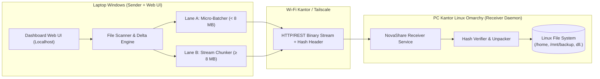
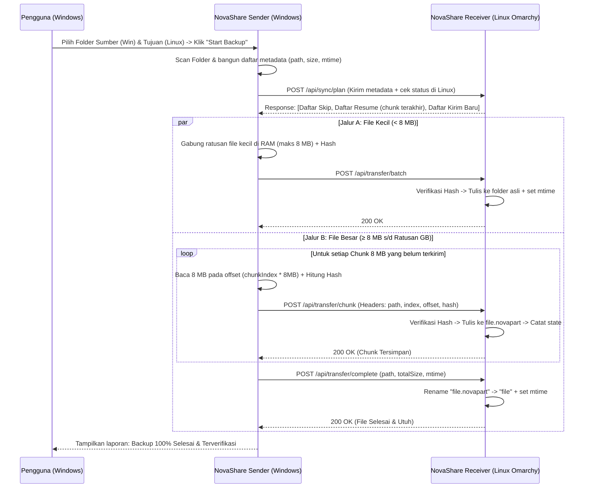

# Product Requirements Document (PRD) — NovaShare

| Metadata | Detail |
| :--- | :--- |
| **Nama Produk** | **NovaShare** |
| **Versi Dokumen** | 1.0.0 |
| **Tanggal** | 13 November 2026 |
| **Platform Sumber (Sender)** | Windows (Laptop Kerja) |
| **Platform Tujuan (Receiver)** | Linux Omarchy (PC Kantor) |
| **Jaringan Target** | Wi-Fi Kantor (LAN) & Tailscale VPN (Mesh P2P) |

---

## 1. Latar Belakang & Tujuan Masalah

Proses backup data kerja dari laptop (Windows) ke PC kantor (Linux Omarchy) menggunakan jaringan Wi-Fi kantor sering terkendala oleh dua masalah ekstrem:
1. **File Berukuran Raksasa (Puluhan hingga Ratusan GB):** Pengiriman file utuh rentan gagal atau korup jika Wi-Fi kantor *drop* sesaat, laptop *sleep*, atau jam kerja selesai. Mengulang dari 0% sangat membuang waktu.
2. **Ribuan Folder & File Berukuran Kecil:** Mengirim ratusan ribu file kecil (seperti *source code*, aset, dokumen) satu per satu menimbulkan *network round-trip overhead* dan *disk I/O bottleneck* yang membuat kecepatan transfer jatuh drastis.

### Tujuan Produk (Product Goals)
- **Zero Corruption:** Setiap blok data yang dikirim wajib diverifikasi dengan *cryptographic hash* sebelum disimpan permanen.
- **Instant Auto-Resume:** Jika koneksi Wi-Fi terputus atau laptop dibawa pulang, proses backup dapat dilanjutkan tepat dari potongan (*chunk*) terakhir (8 MB) melalui Wi-Fi kantor maupun Tailscale.
- **1:1 Native Folder Structure:** Hasil backup di PC Linux Omarchy tersimpan sesuai struktur folder asli (bukan terkunci di dalam satu file `.tar`/`.zip`), sehingga bisa langsung dibuka di Linux.
- **High Throughput untuk Semua Ukuran File:** Menggunakan mesin **Dual-Lane Pipeline** (*Micro-Batching* untuk file kecil & *Chunk Streaming* untuk file ratusan GB).
- **Kemudahan ala LocalSend, Ketangguhan ala Enterprise Backup:** Pengguna dapat memilih folder tujuan di PC Linux langsung dari layar laptop Windows tanpa perlu konfirmasi manual berulang di PC Linux.

---

## 2. Arsitektur Sistem

NovaShare menggunakan arsitektur **Single Codebase, Dual-Role** (satu aplikasi yang dapat dijalankan sebagai *Sender* maupun *Receiver*):



1. **NovaShare Receiver (Linux Omarchy):**
   - Berjalan di *background* (sebagai *systemd service* atau CLI daemon) pada port tertentu (misal `7654`).
   - Melayani permintaan penjelajahan folder (*remote directory browser*), pengecekan sisa ruang disk, validasi *manifest* untuk *delta sync*, verifikasi *hash*, serta penulisan data ke disk secara atomik.
2. **NovaShare Sender & Dashboard (Windows):**
   - Menyediakan antarmuka Web UI lokal untuk memilih folder sumber di Windows, memilih folder tujuan di Linux, memantau kecepatan transfer secara *real-time*, mengatur *pause/resume*, dan menyimpan profil/pasangan folder (*Preset Job*).

---

## 3. Kebutuhan Fungsional (Functional Requirements)

### FR-01: Koneksi, Pairing, & Keamanan
- **FR-01.1:** Pengguna dapat memasukkan alamat IP PC Linux (IP LAN Wi-Fi kantor `192.168.x.x` atau IP Tailscale `100.x.y.z`) beserta Port dan *Secret Token / PIN*.
- **FR-01.2:** Semua *endpoint* di PC Linux wajib memvalidasi header `X-Nova-Token` agar perangkat asing di Wi-Fi kantor tidak dapat mengakses atau mengirim file sembarangan.
- **FR-01.3:** Mendukung *unattended transfer* (sekali *token* tersimpan, backup langsung berjalan tanpa perlu klik *"Accept"* di layar PC Linux).

### FR-02: Pemilihan Folder Tujuan di Linux (Remote Directory Explorer)
- **FR-02.1:** Dari UI laptop Windows, pengguna dapat menelusuri struktur direktori PC Linux Omarchy (misal `/home/user`, `/mnt`, `/media`).
- **FR-02.2:** Pengguna dapat membuat folder baru langsung di PC Linux melalui UI Windows.
- **FR-02.3:** Menampilkan informasi **Total Disk Space** dan **Free Space** dari partisi folder tujuan di Linux, serta memberi peringatan jika ukuran backup melebihi sisa ruang kosong.
- **FR-02.4:** Pengguna dapat menyimpan pasangan `Folder Sumber (Windows) -> Folder Tujuan (Linux)` sebagai *Saved Backup Profile*.

### FR-03: Pre-Flight Scan, Delta Sync, & Smart Ignore
- **FR-03.1:** Sebelum mengirim data, Sender melakukan *scanning* rekursif pada folder sumber dan mencatat: `relativePath`, `size` (byte), dan `mtime` (waktu modifikasi terakhir).
- **FR-03.2:** Sender mengirim daftar *metadata* secara bertahap ke Receiver Linux untuk dibandingkan dengan file yang sudah ada di folder tujuan:
  - **SKIP:** Jika file di Linux sudah ada dengan `size` dan `mtime` yang identik.
  - **RESUME:** Jika ditemukan file `.novapart` dan *state* chunk dari sesi sebelumnya yang belum selesai.
  - **TRANSFER:** Jika file belum ada atau sudah berubah.
- **FR-03.3:** Menyediakan opsi **Ignore Filter** yang dapat diaktifkan/nonaktifkan (contoh: melewati `node_modules/`, `.git/`, `vendor/`, `*.tmp`, `Thumbs.db`).

### FR-04: Dual-Lane Transfer Engine
Untuk memaksimalkan kecepatan di jaringan Wi-Fi, file yang masuk antrean dibagi menjadi 2 jalur:

#### Jalur A — Micro-Batching (File Kecil `< 8 MB`)
- **FR-04.1:** File-file kecil tidak dikirim satu per satu, melainkan dikumpulkan di memori (RAM) hingga mencapai batas paket `~8 MB` (atau maksimal `200 file` per paket).
- **FR-04.2:** Setiap paket *batch* dilengkapi header berisi daftar `relativePath`, `size`, `mtime`, dan `hash` paket secara keseluruhan.
- **FR-04.3:** Receiver Linux memverifikasi *hash* paket; jika cocok, langsung mengekstrak seluruh file ke sub-folder tujuan masing-masing dan menyamakan `mtime`-nya.

#### Jalur B — Chunked Streaming (File Besar `>= 8 MB` s/d Ratusan GB)
- **FR-04.4:** File besar dibaca menggunakan *file stream* per potongan tetap (**Chunk Size: 8 MB**) langsung dari disk tanpa menduplikasi file di laptop Windows.
- **FR-04.5:** Setiap chunk 8 MB dihitung *cryptographic hash*-nya (SHA-256 / BLAKE3) dan dikirim ke Linux bersama `fileId`, `chunkIndex`, dan `offset`.
- **FR-04.6:** Receiver Linux memverifikasi *hash* chunk yang masuk:
  - Jika cocok: ditulis ke posisi `offset` pada file sementara `<namafile>.novapart` dan indeks chunk dicatat ke file state.
  - Jika tidak cocok (korup di jalan): Receiver menolak chunk tersebut (`HTTP 422`), dan Sender otomatis mengirim ulang chunk 8 MB itu saja.
- **FR-04.7:** Setelah seluruh chunk terkirim (100%), Sender memanggil *endpoint* finalisasi, dan Receiver mengubah nama `<namafile>.novapart` menjadi `<namafile>` secara atomik (*atomic rename*) serta menyamakan `mtime` dengan file asli di Windows.

### FR-05: Auto-Pause, Auto-Resume, & Network Recovery
- **FR-05.1:** Jika koneksi Wi-Fi terputus di tengah pengiriman, proses tidak dinyatakan gagal total, melainkan masuk ke status `WAITING_FOR_NETWORK`.
- **FR-05.2:** Sender melakukan *health-check ping* ke IP Linux setiap 3–5 detik. Saat koneksi kembali pulih, pengiriman otomatis dilanjutkan dari `chunkIndex` atau `batch` terakhir yang belum selesai.
- **FR-05.3:** Jika laptop dimatikan dan keesokan harinya dibuka kembali, pengguna cukup menekan tombol **Resume / Start** pada profil yang sama; sistem otomatis mengenali file `.novapart` di Linux dan melanjutkan sisanya.

### FR-06: Monitoring Real-Time & Bandwidth Limiter
- **FR-06.1:** Dashboard menampilkan:
  - Progress keseluruhan (GB terkirim / Total GB, Persentase, Estimasi waktu selesai / ETA).
  - Kecepatan transfer *real-time* (MB/s).
  - File/Chunk yang sedang dikirim saat ini.
  - Statistik file: Jumlah file *Skipped (Delta)*, *Completed*, dan *Remaining*.
- **FR-06.2:** Fitur **Bandwidth Throttling** (opsional: Tanpa Batas, 10 MB/s, 20 MB/s, Custom) agar tidak menghabiskan seluruh bandwidth Wi-Fi kantor saat jam kerja.

---

## 4.Alur Kerja Sistem (System Sequence)



---

## 5. Spesifikasi Endpoint API (Receiver Linux)

Semua endpoint membutuhkan header autentikasi: `X-Nova-Token: <secret_token>`.

| Method | Endpoint | Deskripsi |
| :--- | :--- | :--- |
| `GET` | `/api/system/info` | Mengecek koneksi, nama *hostname* Linux, OS, dan versi NovaShare. |
| `GET` | `/api/fs/browse?path=/...` | Membaca daftar direktori di Linux beserta informasi *free disk space*. |
| `POST` | `/api/fs/mkdir` | Membuat direktori baru di PC Linux. |
| `POST` | `/api/sync/plan` | Menerima daftar metadata file dari Windows; mengembalikan status per file (`SKIP`, `RESUME`, `NEW`) beserta daftar `completedChunks` jika ada `.novapart`. |
| `POST` | `/api/transfer/batch` | Menerima *binary payload* gabungan file-file kecil (`< 8 MB`), memverifikasi hash, dan mengekstraknya ke folder tujuan. |
| `POST` | `/api/transfer/chunk` | Menerima *binary stream* 1 chunk (`8 MB`), memverifikasi hash, dan menulis ke `<file>.novapart` pada `offset` terkait. |
| `POST` | `/api/transfer/complete` | Memvalidasi ukuran akhir `<file>.novapart`, mengubah nama menjadi file asli secara atomik, menyesuaikan `mtime`, dan menghapus file *state* sementara. |

---

## 6. Format Penyimpanan Sementara & State Resume di Linux

Agar proses *resume* tahan terhadap mati lampu atau putus koneksi kapan saja, Receiver Linux menggunakan mekanisme berikut pada folder tujuan:

1. **File Sementara (`<namafile>.novapart`):**
   - Dibuat saat chunk pertama diterima dengan ukuran yang dialokasikan sesuai `totalSize` (atau ditulis berdasarkan *byte offset*).
   - Tidak akan menimpa file backup lama sebelum 100% chunk selesai dan terverifikasi.
2. **File Catatan Chunk (`<namafile>.novapart.meta.json`):**
   ```json
   {
     "relativePath": "vm-images/ubuntu-prod.vhdx",
     "totalSize": 107374182400,
     "sourceMtime": 1763020800000,
     "chunkSize": 8388608,
     "totalChunks": 12800,
     "completedChunks": [0, 1, 2, 3, "..."]
   }
   ```
   - Begitu seluruh `12800` chunk selesai, `<namafile>.novapart` di-*rename* menjadi `ubuntu-prod.vhdx`, dan file `.meta.json` dihapus otomatis.

---

## 7. Kebutuhan Non-Fungsional (Non-Functional Requirements)

1. **Penggunaan Memori Rendah (Low Memory Footprint):**
   - Walaupun membackup file berukuran **500 GB**, penggunaan RAM aplikasi di Windows maupun Linux tidak boleh melebihi **150–250 MB** karena file dibaca dan ditulis menggunakan *stream per 8 MB*.
2. **Kecepatan & Konkurensi:**
   - Mendukung pengiriman paralel (*worker pool* 2–4 koneksi simultan yang dapat diatur) agar saturasi *bandwidth* Wi-Fi kantor/Tailscale optimal.
3. **Cross-Platform Path Safety:**
   - Otomatis mengonversi pemisah path Windows (`\`) menjadi standar POSIX Linux (`/`) dan menjaga keamanan dari serangan *path traversal* (`../`).
4. **Zero External Database Dependency:**
   - Tidak membutuhkan instalasi database berat (seperti MySQL/PostgreSQL) di Windows maupun Linux; seluruh konfigurasi dan *state* disimpan dalam file JSON/SQLite lokal yang ringan.

---

## 8. Tahapan Implementasi (Roadmap)

- **Fase 1 — Core Engine & Receiver API:**
  - Pembuatan server HTTP Receiver (info sistem, *remote directory browser*, cek *free space*, autentikasi token).
  - Implementasi endpoint `/api/sync/plan`, `/api/transfer/chunk`, `/api/transfer/complete`, dan `/api/transfer/batch`.
- **Fase 2 — Sender Engine (Dual-Lane + Auto-Resume):**
  - Pembuatan *Scanner*, *Delta Sync comparator*, *Micro-Batcher* (file kecil), dan *Chunk Streamer* (file ratusan GB) beserta *auto-retry* saat jaringan putus.
- **Fase 3 — Web UI Dashboard:**
  - Antarmuka pemilihan folder Windows & *Modal File Explorer* untuk memilih folder di PC Linux Omarchy.
  - *Progress bar* real-time, indikator kecepatan (MB/s), tombol *Pause/Resume*, profil tersimpan, dan pengaturan *Ignore Filter* / *Bandwidth Limit*.
- **Fase 4 — Kemudahan Deployment:**
  - Skrip penjalan satu klik untuk Windows (`start-windows.bat`) dan skrip/service untuk Linux Omarchy (`start-linux.sh` / *systemd service*).
---

## 9. Tech Stack & Struktur Direktori

### Tech Stack Utama
- **Runtime & Bundler:** **Bun (TypeScript)** — Mendukung kompilasi *single-file executable* (`bun build --compile`) untuk Windows (`novashare-windows.exe`) dan Linux Omarchy (`novashare-linux`) tanpa instalasi runtime tambahan di mesin tujuan.
- **Protokol Transfer:** HTTP Binary Stream (`application/octet-stream`) untuk efisiensi memori pada file ratusan GB + Server-Sent Events (SSE) untuk *real-time progress* di UI.
- **Integritas Data:** Native `Bun.CryptoHasher` (`SHA-256` / `BLAKE2b`) untuk verifikasi setiap chunk (`8 MB`) dan paket *micro-batch*.
- **Penyimpanan State:** File JSON ringan (`.novapart.meta.json` di sisi Receiver & `.novashare-config.json` di sisi Sender).

### Struktur Folder Project
```text
nova-share/
├── prd.md                        # Dokumen spesifikasi produk (PRD)
├── README.md                     # Dokumentasi utama & panduan penggunaan
├── package.json                  # Konfigurasi project & script build executable
├── tsconfig.json                 # Konfigurasi TypeScript untuk Bun
├── src/
│   ├── index.ts                  # Entry point CLI (--sender, --receiver, atau dual-mode)
│   ├── shared/                   # Types, constants, hashing, batch-codec, path-utils
│   ├── receiver/                 # Linux Omarchy Receiver Daemon (API, fs-browser, chunk/batch writer)
│   ├── sender/                   # Windows Sender Engine (scanner, transfer-manager, chunk/batch sender)
│   └── ui/                       # Web Dashboard UI (HTML/CSS/JS embedded)
├── scripts/                      # Helper scripts (start-windows.bat, start-linux.sh, novashare.service)
└── dist/                         # Output executable mandiri hasil kompilasi
```

